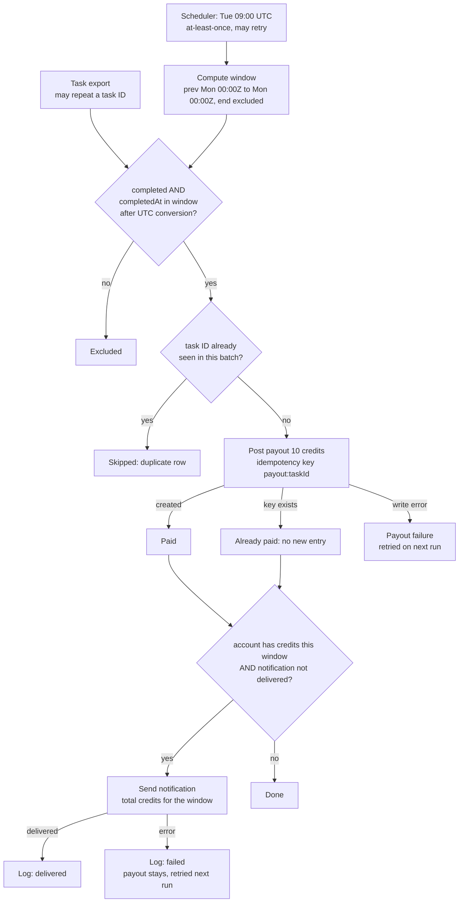

# Settlement flow map

Fictional rewards service. These are assessment rules, not a description of a live product.

## Where each risk sits

| Step | Risk | Covered by |
|---|---|---|
| Scheduler | runs twice (retry, manual re-run) | TC-08, TC-09, TC-13 |
| Task export | same task ID twice, or re-sent next week | TC-07, TC-10 |
| Window | wrong week at the cut-off, Tue 08:59 vs 09:00 | TC-01, TC-02, TC-04 |
| Timestamps | non-UTC offsets shift a task across the cut-off | TC-05 |
| Filter | non-completed tasks paid | TC-06 |
| Payout | partial ledger failure | TC-09, TC-12 |
| Notification | sent without a payout, failure reverses payout, sent twice | TC-11, TC-12, TC-13 |
